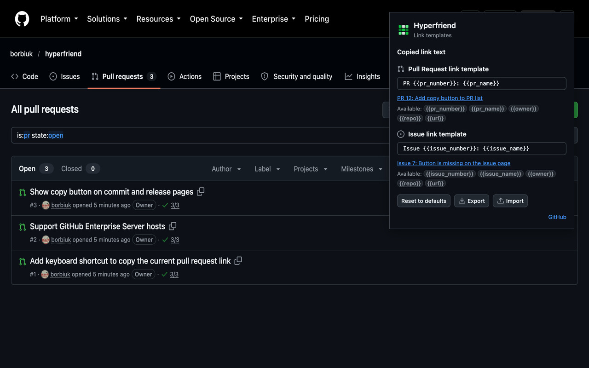

<p align="center"></p>

# Hyperfriend

Hyperfriend is a **browser extension for Chrome and Firefox** that adds a one-click **copy link** button to every
Pull Request and Issue on [GitHub](https://github.com). The button copies a rich hyperlink, so a pasted link in
Microsoft Teams, Slack and other chats shows readable text such as `PR 12: Add copy button to PR list`
instead of a bare URL.

Chrome Web Store and Firefox Add-ons listings are coming soon.

<p align="center"></p>

<hr/>

## Features

### Copy button

- **Pull Requests and Issues**: a button next to the title of every item in list views and next to the title on the detail pages.
- **Rich hyperlink**: the clipboard gets both formats at once, so every chat app picks the best one.
    - `text/html`: `<a href="https://github.com/OWNER/REPO/pull/12">PR 12: Add copy button to PR list</a>`
    - `text/plain`: `PR 12: Add copy button to PR list — https://github.com/OWNER/REPO/pull/12`
- **Looks like GitHub**: styled like GitHub's own icon buttons (Primer "invisible" icon button, 24 px in lists and 32 px in page headers), with GitHub-style tooltips ("Copy link to pull request" / "Copy link to issue"). On detail pages it sits right after the `#number` of the title.
- **Clear feedback**: after a click the icon changes to a check mark and the tooltip shows "Copied!", or a cross and "Copy failed", for 1.5 seconds. Screen readers announce the result, and the accessible label is, for example, "Copy link to pull request #12".
- **Works with GitHub navigation**: buttons appear on pages that GitHub loads without a full page refresh and are never duplicated.
- **Light and dark**: the button uses GitHub's own theme colors, so it follows the GitHub theme you use.

### Author avatars

- **Who opened it**: in Pull Request lists a small round avatar (16 px) is shown before the author's login, like on other GitHub pages.
- **Light on requests**: avatars load lazily from GitHub's own avatar server (`avatars.githubusercontent.com`), the same images GitHub shows. If an avatar cannot be loaded, it is simply removed.
- **Only where it helps**: not shown in Issue lists or search results, and not added where GitHub already shows an avatar (for example Copilot rows).

### Customizable templates

Click the Hyperfriend icon in the browser toolbar to open the settings popup. It has one template for Pull Request
links and one for Issue links. Defaults:

- Pull Request: `PR {{pr_number}}: {{pr_name}}`
- Issue: `Issue {{issue_number}}: {{issue_name}}`

| Placeholder        | Available in  | Replaced with                  | Example                      |
| ------------------ | ------------- | ------------------------------ | ---------------------------- |
| `{{pr_number}}`    | Pull Requests | Pull Request number            | `12`                         |
| `{{pr_name}}`      | Pull Requests | Pull Request title             | `Add copy button to PR list` |
| `{{issue_number}}` | Issues        | Issue number                   | `34`                         |
| `{{issue_name}}`   | Issues        | Issue title                    | `Button is not shown`        |
| `{{owner}}`        | Both          | Repository owner               | `borbiuk`                    |
| `{{repo}}`         | Both          | Repository name                | `hyperfriend`                |
| `{{url}}`          | Both          | Canonical Pull Request / Issue | `https://github.com/…`       |

Notes:

- Spaces inside the braces are allowed: `{{ pr_number }}`.
- Unknown placeholders (including the ones of the other link type) are left as they are.
- An empty template falls back to the default one.
- Settings are saved in the browser sync storage, so they follow you across devices signed in to the same browser account.

### Sharing templates with your team

Export your templates to a file and let teammates import it, so everybody pastes links in the same format.

1. Open the Hyperfriend popup and click **Export**. The browser downloads `hyperfriend-settings.json`.
2. Share the file (chat, repository, wiki).
3. A teammate opens the popup, clicks **Import** and picks the file. The fields update and "Settings imported." is shown.

In Chrome, Export and Import work right in the popup. In **Firefox** the popup closes when the download panel or the file picker opens, so **both Export and Import** open the settings page in a browser tab (`options_ui` with `open_in_tab`), where they work the same way. The settings page is also available from the extension's options in the browser's extensions manager.

File format (schema version 1):

```json
{
	"app": "hyperfriend",
	"schemaVersion": 1,
	"exportedAt": "2026-10-19T18:00:00.000Z",
	"templates": {
		"pull-request": "PR {{pr_number}}: {{pr_name}}",
		"issue": "Issue {{issue_number}}: {{issue_name}}"
	}
}
```

Import rules:

- The file must be up to 64 KB (larger files are rejected before they are read) and valid JSON, with `"app": "hyperfriend"` and `"schemaVersion": 1`. A higher version is rejected as "created by a newer version of Hyperfriend".
- `templates` must be an object. Only the keys `pull-request` and `issue` are read; other keys are ignored. Values are trimmed, and each must be a single line of text (no line breaks or control characters) of at most 500 characters; otherwise the error reads `Template "<key>" must be a single line of text up to 500 characters.` At least one known template must be present.
- A template missing from the file keeps its current value. Everything is applied with one write to the sync storage.
- Problems are shown as a short message under the buttons, and nothing is changed.
- `exportedAt` is informational only.

### Settings popup

- **GitHub look**: built with Primer React, the design system of GitHub.
- **Header**: the popup shows the extension icon next to the name.
- **Live preview**: each template field is marked with a Pull Request or Issue icon, lists the available placeholders and shows the resulting link text for a sample item.
- **Autosave**: changes are saved about 300 ms after you stop typing, with a "Saved" status.
- **Footer**: **Reset to defaults** restores both templates, **Export** and **Import** share them as a file (see above), and a link opens the GitHub repository.
- **Light and dark themes**: the popup follows the operating system theme.

<hr/>

## Supported Pages

All pages are on `github.com`.

| Page Type                 | URL                                                                                                                                 | What you get                                       |
| ------------------------- | ----------------------------------------------------------------------------------------------------------------------------------- | -------------------------------------------------- |
| **Repository PR list**    | `/OWNER/REPO/pulls`, filters `/pulls/assigned/USER`, `/created_by/USER`, `/mentioned/USER`, `/review-requested/USER`, `/pulls/USER` | Copy button after every item title                 |
| **Repository Issue list** | `/OWNER/REPO/issues`, filters `/issues/assigned/USER`, `/created_by/USER`, `/mentioned/USER`, `/review-requested/USER`              | Copy button after every item title                 |
| **Dashboards**            | `/pulls`, `/issues` and their `assigned`, `created`, `mentioned`, `review-requested`, `recent-activity` tabs \*                     | Copy button after every item title                 |
| **Search results**        | `/search?type=pullrequests`, `/search?type=issues`                                                                                  | Copy button after every result title               |
| **Pull Request page**     | `/OWNER/REPO/pull/12`, including `/files`, `/commits`, `/checks`                                                                    | Copy button right after the `#number` of the title |
| **Issue page**            | `/OWNER/REPO/issues/34`                                                                                                             | Copy button right after the `#number` of the title |

Author avatars are added to the Pull Request lists only (the repository and dashboard lists); Issue lists and search results do not get them. Other pages (for example `/OWNER/REPO/issues/new`) are left untouched.

\* The dashboards are supported by the code but have not been verified on live GitHub pages yet (they require signing in).

<hr/>

## Development

### Requirements

- Node.js 22 or newer (enforced by `engines` and `engine-strict`).
- `jq` and `zip` for `zip.sh` (packaging) and the pre-commit hook, which builds and zips both browsers on every commit.

### Installation

#### Chrome

1. Open the Google Chrome browser.
2. Navigate to `chrome://extensions/` and enable Developer Mode by toggling the switch in the top right corner.
3. Run `npm install` in the root of repository.
4. Run `npm run build` in the root of repository.
5. Click on `Load unpacked` and select the `dist` directory created after previous step.
6. The extension should now appear in your list of installed extensions and is ready to use.

#### Firefox

Firefox 140 or newer is required (Firefox for Android: 142 or newer).

1. Run `npm install` in the root of repository.
2. Run `npm run build:firefox` in the root of repository.
3. Navigate to `about:debugging#/runtime/this-firefox`.
4. Click on `Load Temporary Add-on...` and select the `manifest.json` file inside the `dist-firefox` directory.
5. The extension should now appear in your list of installed extensions and is ready to use.

> **Note:** Temporary add-ons in Firefox are removed when the browser restarts. Load it again after a restart.

### npm scripts

| Script                   | Description                                                                                  |
| ------------------------ | -------------------------------------------------------------------------------------------- |
| `npm run watch`          | Development build for Chrome into `dist/`, rebuilt on every change.                          |
| `npm run build`          | Production build for Chrome into `dist/`.                                                    |
| `npm run build:firefox`  | Production build for Firefox into `dist-firefox/`.                                           |
| `npm run clean`          | Remove `dist/` and `dist-firefox/`.                                                          |
| `npm run zip`            | Rebuild both browsers and create `.zip` packages for publishing (runs `zip.sh`).             |
| `npm run typecheck`      | TypeScript 7 type check without emitting files.                                              |
| `npm run lint`           | ESLint for `.ts` / `.tsx` files, followed by the type check.                                 |
| `npm run lint:fix`       | ESLint with automatic fixes.                                                                 |
| `npm run lint:firefox`   | `web-ext lint` for the Firefox build (run `npm run build:firefox` first).                    |
| `npm run format`         | Prettier for `.ts`, `.tsx`, `.js`, `.mjs`, `.json`, `.md`, `.yml`, `.css` and `.html` files. |
| `npm run check:versions` | Fail if any dependency in `package.json` is not pinned to an exact version.                  |
| `npm run check:outdated` | Fail if any dependency is outdated (`npm outdated`). For local use, not run in CI.           |

CI (`.github/workflows/build.yml`) runs `npm ci`, `check:versions`, both builds and both lint scripts on Node 22, 24 and 26.

### File Structure

- `public/`: Contains `manifest.json` (Chrome), `manifest.firefox.json` (Firefox) and `options.html` (popup and settings page).
    - `assets/`: The extension icon PNGs (`logo-16.png`, `logo-32.png`, `logo-48.png`, `logo-128.png`).
- `design/icon/`: Icon sources (SVG for each size) and `render.sh` that renders them into `public/assets/`, see [design/icon/README.md](design/icon/README.md).
- `src/`:
    - `content/`: Content script that adds copy buttons and author avatars on GitHub pages (plain DOM, no React).
        - `components/`: The copy button (`copy-button.ts`) and the shared tooltip (`tooltip.ts`).
        - `icons/`: Inline SVG Octicons (copy, check, x).
        - `services/`: Page detection, link target parsing, button injection, author avatar injection, DOM observer and the config store.
        - `styles/`: CSS of the button, tooltip and avatar (uses GitHub's Primer CSS variables).
        - `content.ts`: The entry of the content script.
    - `options/`: Toolbar popup (settings), a React app built with Primer React.
        - `components/`: React components of the popup (`options-app.tsx`, `settings-section.tsx`, `template-field.tsx`, `footer-actions.tsx` with reset, export and import).
        - `hooks/`: React hooks (`use-config.ts` loads the config and keeps it fresh, `use-view-mode.ts` tells popup from tab).
        - `utils/`: Helpers (`download-text.ts` saves a file without the `downloads` permission).
        - `options.tsx`: The entry of the popup.
    - `shared/`: Models, constants, services (templates, config, clipboard, settings import/export) and utils, imported via `@shared/*`.
    - `types/`: Ambient type declarations (`global.d.ts` allows `*.css` imports).
- `webpack/`: Configuration of webpack for the Chrome (`dist/`) and Firefox (`dist-firefox/`) builds.
- `scripts/`: Maintenance scripts (`check-versions.mjs`, `tag-releases.sh` for tagging released versions).
- `.github/`: Issue and pull request templates, CI workflow (build + lint on pushes and pull requests to `master`).
- `.husky/`: Git pre-commit hook: syncs the version, formats files, stages changes of tracked files and builds both browsers into `.zip` packages (see [AGENTS.md](AGENTS.md)).
- `.claude/`: Agent context for AI-assisted development (rules, skills, subagents, shared settings), see [AGENTS.md](AGENTS.md).
- `.mcp.json`: Project MCP servers for AI-assisted development (Chrome DevTools MCP).
- `zip.sh`: A script for creating `.zip` files with builds for publishing.

There is no background script or service worker: the content script talks to `chrome.storage` directly.

### Tooling notes

#### Exact dependency versions

Every dependency in `package.json` is pinned to an exact version: no `^`, no `~`, no ranges. `.npmrc` sets
`save-exact=true`, so `npm install <package>` saves an exact version.

- Add or update a package with `npm install -E <package>@latest` (or `-D -E` for dev dependencies).
- `npm run check:versions` verifies the pins (npm aliases like `npm:typescript@7.0.2` are accepted when the version is exact).
- `npm run check:outdated` lists everything that has a newer version. Run it locally from time to time.

#### TypeScript 7

- `typescript7` is an alias of the TypeScript 7 package. `npm run typecheck` runs its compiler
  (`node node_modules/typescript7/bin/tsc --noEmit`), and `npm run lint` runs the type check after ESLint.
- `typescript` is an alias of `@typescript/typescript6`, the TypeScript 6 package that keeps the JavaScript API
  which `ts-loader` and `typescript-eslint` still need.
- `ts-loader` runs with `transpileOnly`, so webpack builds do not type check. Use `npm run typecheck` or `npm run lint`.

#### Versions

The version lives in `public/manifest.json`. The pre-commit hook copies it to `package.json` and
`public/manifest.firefox.json`, so change only `public/manifest.json`.

### Store submission notes

- **Store assets** (promo tiles, screenshots and their sources) live in `design/store/`; see [design/store/README.md](design/store/README.md) for which file goes where in the Chrome Web Store dashboard and how to regenerate them.
- **Chrome Web Store**: upload the `hyperfriend-build-chrome_*.zip` created by `npm run zip`. The 128×128 icon the store requires is part of the package (`assets/logo-128.png`; see [design/icon](design/icon/README.md)).
- **Firefox Add-ons (AMO)**: upload `hyperfriend-build-firefox_*.zip`. Because the code is bundled and minified, AMO also needs a **source archive**: the repository without `node_modules/`, `dist/` and `dist-firefox/`. Build steps for the reviewer:
    1. Use Node.js 22 or newer.
    2. Run `npm ci`.
    3. Run `npm run build:firefox`.
    4. The result is in `dist-firefox/`, and its `content.js`, `options.js`, `options.html` and `manifest.json` are the submitted files.
- **Reviewer notes for `web-ext lint`**: `npm run lint:firefox` reports 4 warnings, all in `options.js` and all from bundled third-party code (React, Primer and lodash): one `DANGEROUS_EVAL` (a `Function` constructor) and three `UNSAFE_VAR_ASSIGNMENT` (`innerHTML`). The extension's own code does not use `eval`, `innerHTML` or remote code, and `content.js` (the only script that runs on web pages) has none of these warnings.

### Contributing

We welcome contributions! If you would like to contribute to this project, please:

1. Fork the repository.
2. Create a new branch for your feature or fix.
3. Commit your changes.
4. Push the branch to your fork.
5. Submit a pull request to the original repository.

For any issues or queries during installation or usage, refer to
our [Issues Section](https://github.com/borbiuk/hyperfriend/issues).

Your contributions and feedback are greatly appreciated!
