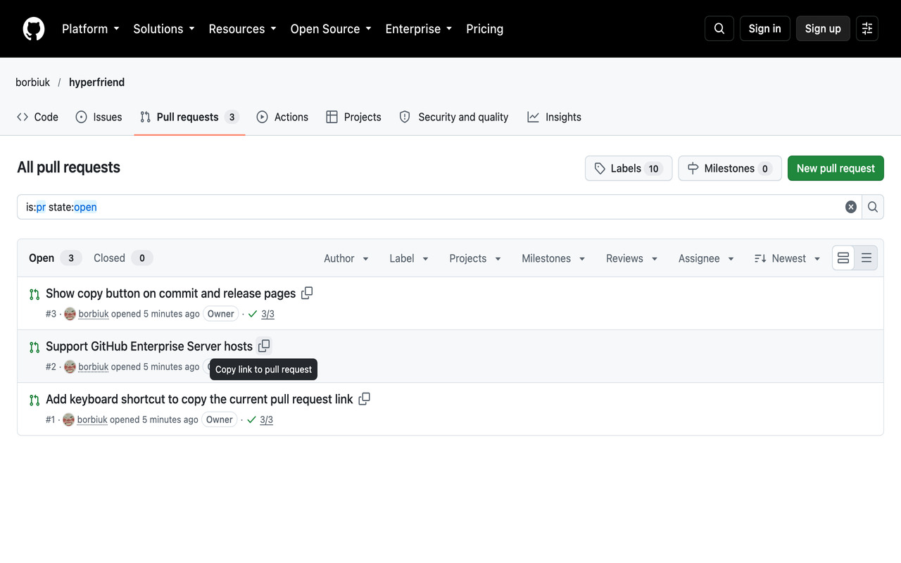

# Hyperfriend

**Paste GitHub links in Slack, Teams and docs as readable text, not bare URLs.**

Hyperfriend is a browser extension for Chrome and Firefox. It adds a one-click **copy link** button to every Pull Request, Issue, Discussion and workflow run on GitHub. A pasted link shows your own text, for example `PR 12: Add copy button to PR list` with `PR 12` as the link, instead of a long address.

## Why

- **Chats show a bare URL.** A copied GitHub address says nothing about what it points to, and long ones get cut off.
- **Hyperfriend copies a link with text.** The clipboard gets a rich hyperlink for chat apps and a plain-text fallback for everything else. Prefer Markdown? Switch the copy format and paste `[PR 12](https://…): Add copy button` into comments, Notion or docs.
- **It stays out of your way.** The button looks like GitHub's own, works after GitHub's in-page navigation and never gets in the way of typing.

## What you get

- A **copy button** on lists and detail pages of Pull Requests, Issues, Discussions and workflow runs, in light and dark.
- **Your own templates** with placeholders such as `{{pr_number}}`, `{{pr_name}}`, `{{author}}`, `{{labels}}` and `{{branch}}`. Only the part in `[square brackets]` is the link.
- **Quick filters** under the search box of Pull Request lists: named like the groups of Linear Reviews (needs your review, needs review from your GitHub team, created by you, ready to merge), plus drafts, CI state and your own Pull Requests by review state, each with an icon, one click, in the order you choose, and remembered if you want. Add your own chips with a name, icon, colour and any GitHub search filter.
- **Copy several items** at once: Shift+click the buttons in a list, then copy them as one bulleted list.
- A **keyboard shortcut** (Shift+C by default) on an open item, which you can change or turn off.
- **Share your setup**: export the settings to a file and import it on another computer, so a whole team pastes links in one format.
- **GitHub Enterprise**: `*.ghe.com` works with no setup, and Enterprise Server domains are added in the settings.

The details are in [Usage](docs/usage.md), [Templates and settings files](docs/templates.md) and [GitHub Enterprise](docs/enterprise.md).

## Install

The Chrome Web Store and Firefox Add-ons listings are coming soon. Until then:

1. Download `hyperfriend-chrome-x.y.z.zip` or `hyperfriend-firefox-x.y.z.zip` from the [latest release](https://github.com/borbiuk/hyperfriend/releases/latest) and unzip it.
2. **Chrome**: open `chrome://extensions`, turn on **Developer mode**, click **Load unpacked** and pick the unzipped folder.
3. **Firefox** (140 or newer): open `about:debugging#/runtime/this-firefox`, click **Load Temporary Add-on...** and pick `manifest.json` from the unzipped folder. Firefox removes temporary add-ons when it restarts.

You can also build it from the source: see [Development](docs/development.md).

## Privacy

No data collection, no analytics, no servers of its own. The settings stay in your browser's extension storage, and the only network request is the optional author picture that GitHub's own server provides. Read the full [privacy policy](PRIVACY.md).

## Contributing

Bug reports, ideas and pull requests are welcome. Read [CONTRIBUTING.md](.github/CONTRIBUTING.md) first. For questions see [SUPPORT.md](.github/SUPPORT.md), for security problems [SECURITY.md](SECURITY.md). The release history is in [RELEASE_NOTES.md](RELEASE_NOTES.md).

## License

[MIT](LICENSE)
