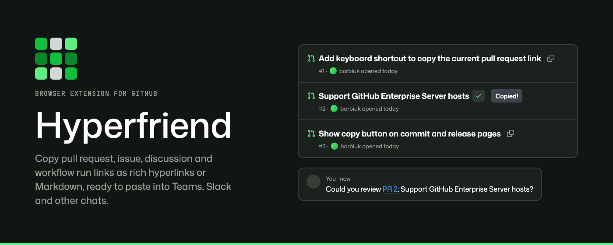
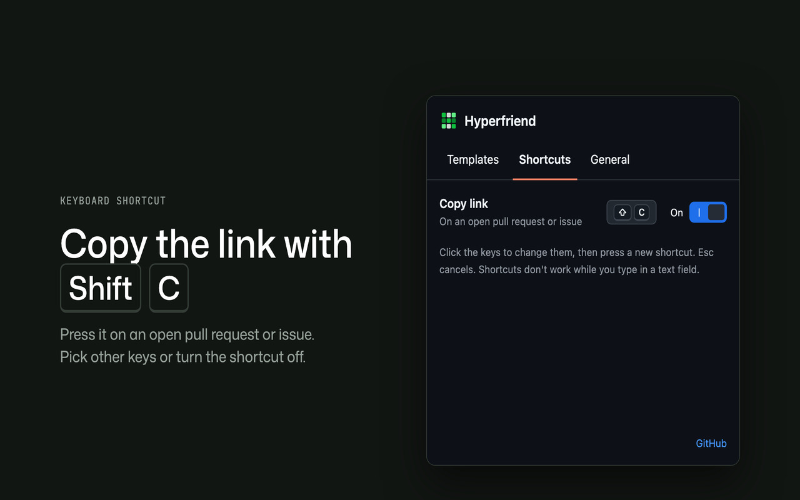

<p align="center"></p>

# Hyperfriend

Hyperfriend is a **browser extension for Chrome and Firefox** that adds a one-click **copy link** button to every
Pull Request, Issue, Discussion and workflow run on [GitHub](https://github.com). The button copies a rich hyperlink, so a pasted link in
Microsoft Teams, Slack and other chats shows readable text such as `PR 12: Add copy button to PR list`
(with `PR 12` as the link) instead of a bare URL. On an open Pull Request, Issue, Discussion or workflow run, a **keyboard shortcut** (Shift+C by default) copies the same link.

Chrome Web Store and Firefox Add-ons listings are coming soon.

<p align="center"></p>

<hr/>

## Features

### Copy button

- **Pull Requests, Issues, Discussions and workflow runs**: a button next to the title of every item in list views and next to the title on the detail pages. A workflow run is linked as `WORKFLOW #RUN_NUMBER` (for example `CI #20481`) with the run's name as the text after it.
- **Rich hyperlink** (the default copy format): the clipboard gets both formats at once, so every chat app picks the best one.
    - `text/html`: `<a href="https://github.com/OWNER/REPO/pull/12">PR 12</a>: Add copy button to PR list` (with the default template only `PR 12` is the link, see [Customizable templates](#customizable-templates))
    - `text/plain`: `PR 12: Add copy button to PR list — https://github.com/OWNER/REPO/pull/12`
- **Markdown** (optional): choose **Markdown** under **Copy format** in the **General** tab and the clipboard gets one `text/plain` format with a Markdown link: `[PR 12](https://github.com/OWNER/REPO/pull/12): Add copy button to PR list`. Only the part of the template in square brackets is the link text (the whole text without brackets). Inside the link text `[`, `]` and `\` get a backslash, so `[WIP] Fix` stays one link. There is no `text/html` format in this mode, so chats and editors paste the Markdown source, not a link. The button, the keyboard shortcut and the template preview all follow the setting.
- **Looks like GitHub**: styled like GitHub's own icon buttons (Primer "invisible" icon button, 24 px in lists and 32 px in page headers), with GitHub-style tooltips ("Copy link to pull request" / "Copy link to issue"). On detail pages it sits right after the `#number` of the title.
- **Clear feedback**: after a click the icon changes to a check mark and the tooltip shows "Copied!", or a cross and "Copy failed", for 1.5 seconds. Screen readers announce the result, and the accessible label is, for example, "Copy link to pull request #12".
- **Works with GitHub navigation**: buttons appear on pages that GitHub loads without a full page refresh and are never duplicated.
- **Light and dark**: the button uses GitHub's own theme colors, so it follows the GitHub theme you use.

### Keyboard shortcut

- **Copy the open item**: press **Shift+C** (⇧C on Mac) on an open Pull Request, Issue, Discussion or workflow run to copy its link. It copies exactly what the title copy button copies (same template, same clipboard formats).
- **Where it works**: on the Pull Request page, **Conversation tab only** (`/OWNER/REPO/pull/12`; not Files changed, Commits or Checks), on the Issue page (`/OWNER/REPO/issues/34`), on the Discussion page (`/OWNER/REPO/discussions/5`) and on the workflow run page (`/OWNER/REPO/actions/runs/123`; not its job and attempt pages). Everywhere else the key press is left to GitHub.
- **It never gets in the way of typing**: it does nothing while the focus is in a text field (comment box, search, title editor and similar), while a dialog is open, while holding the key down or while an input method is composing text. Other GitHub shortcuts keep working.
- **Any keyboard layout**: the shortcut uses the physical key (for example the key that is `C` on a US keyboard), so it works with Cyrillic, Greek and other layouts too.
- **Feedback**: the title button shows the usual "Copied!" tooltip. If the button is scrolled out of view, a small "Link copied" toast appears at the bottom of the page for about 2 seconds ("Copy failed" if the copy did not work). Screen readers announce the result, and the title button carries `aria-keyshortcuts` while the shortcut is on.
- **Change or turn it off**: in the **Shortcuts** tab of the popup (see below).

### Author avatars

- **Who opened it**: in Pull Request lists a small round avatar (16 px) is shown before the author's login, like on other GitHub pages.
- **Light on requests**: avatars load lazily from GitHub's own avatar server (`avatars.githubusercontent.com`), the same images GitHub shows. If an avatar cannot be loaded, it is simply removed.
- **Only where it helps**: not shown in Issue lists or search results, and not added where GitHub already shows an avatar (for example Copilot rows).
- **Optional**: turn them off with **Show author avatars** in the **General** tab of the popup. It applies right away, without reloading GitHub.

### Customizable templates

Click the Hyperfriend icon in the browser toolbar to open the settings popup. Its **Templates** tab has one template for Pull Request
links and one for Issue links; the templates for Discussion and workflow run links are under **Discussions and workflow runs**. Defaults:

- Pull Request: `[PR {{pr_number}}]: {{pr_name}}`
- Issue: `[Issue {{issue_number}}]: {{issue_name}}`
- Discussion: `[Discussion {{discussion_number}}]: {{discussion_name}}`
- Workflow run: `[{{workflow}} #{{run_number}}]: {{run_name}}`

**Square brackets mark the link.** Only the text inside `[` and `]` becomes the hyperlink; the rest is plain text. With the defaults a Pull Request pastes as the link "PR 12" followed by the plain text ": Add copy button to PR list". This keeps the link short: Microsoft Teams makes the whole pasted text one blue link and shortens long link text, so a short link such as "PR 12" stays readable.

| Placeholder             | Available in  | Replaced with                                                     | Example                      |
| ----------------------- | ------------- | ----------------------------------------------------------------- | ---------------------------- |
| `{{pr_number}}`         | Pull Requests | Pull Request number                                               | `12`                         |
| `{{pr_name}}`           | Pull Requests | Pull Request title                                                | `Add copy button to PR list` |
| `{{issue_number}}`      | Issues        | Issue number                                                      | `34`                         |
| `{{issue_name}}`        | Issues        | Issue title                                                       | `Button is not shown`        |
| `{{owner}}`             | Both          | Repository owner                                                  | `borbiuk`                    |
| `{{repo}}`              | Both          | Repository name                                                   | `hyperfriend`                |
| `{{url}}`               | Both          | Canonical Pull Request / Issue                                    | `https://github.com/…`       |
| `{{ref}}`               | Both          | Short reference `owner/repo#number`                               | `borbiuk/hyperfriend#12`     |
| `{{author}}`            | Both          | Login of the author                                               | `borbiuk`                    |
| `{{state}}`             | Both          | `open`, `closed`, `merged` or `draft`                             | `merged`                     |
| `{{labels}}`            | Both          | Label names, separated by a comma and a space                     | `bug, ui`                    |
| `{{assignees}}`         | Both          | Assignee logins, separated by a comma and a space                 | `borbiuk, octocat`           |
| `{{milestone}}`         | Both          | Milestone title                                                   | `v2 release`                 |
| `{{base_branch}}`       | Pull Requests | Target branch, as the page shows it                               | `master`                     |
| `{{head_branch}}`       | Pull Requests | Source branch, as the page shows it (`owner:branch` in forks)     | `copy-button`                |
| `{{discussion_number}}` | Discussions   | Discussion number                                                 | `5`                          |
| `{{discussion_name}}`   | Discussions   | Discussion title                                                  | `Ideas for new placeholders` |
| `{{category}}`          | Discussions   | Discussion category                                               | `Ideas`                      |
| `{{run_number}}`        | Workflow runs | Run number shown as `#20481` (not the run id of the URL)          | `42`                         |
| `{{run_name}}`          | Workflow runs | Name of the run (commit message, pull request title, ...)         | `Add copy button to PR list` |
| `{{workflow}}`          | Workflow runs | Workflow name                                                     | `CI`                         |
| `{{branch}}`            | Workflow runs | Branch of the run, as the page shows it (`owner:branch` in forks) | `main`                       |
| `{{status}}`            | Workflow runs | Status in the words of the page                                   | `completed successfully`     |

Where the data comes from: the number, title, owner, repo, `{{url}}` and, for Pull Requests, Issues and Discussions, `{{ref}}` are always known. For a Discussion `{{ref}}` and `{{author}}` are available as for the others; `{{labels}}`, `{{state}}` and the other Pull Request and Issue details are not (they stay as typed). A workflow run has no `{{ref}}`, because a run is not a numbered item of the repository. The other placeholders are read from the page you copy on. A **list row** shows the author, the state and the labels of a Pull Request or Issue, the author and the category of a Discussion, and the workflow, the status and the branch of a workflow run (search results show none of them); a **Pull Request or Issue page** shows all of them (the branches on Pull Requests only). A placeholder whose data the page does not show is replaced with nothing, so `{{labels}}` is empty when the item has no labels or the row shows none.

Notes:

- Brackets are read in the template only, before the placeholders are filled, so brackets in a title (for example `[WIP] Fix`) never matter.
- The first `[`…`]` pair is the link; later brackets are plain text. A `[` without a closing `]` is plain text too. Write `\[` or `\]` for a literal bracket.
- Without brackets, or with an empty `[]`, the whole text is the link, exactly as in 2.0.0 and earlier: `PR {{pr_number}}: {{pr_name}}` pastes as one link "PR 12: Add copy button to PR list".
- Spaces at the edges of the bracketed part stay outside the link: `[ PR {{pr_number}} ]: …` links only "PR 12".
- A bracket can't cut through a placeholder: `{{pr_[number]}}` is not a placeholder.
- `text/plain` never contains the brackets: `PR 12: Add copy button to PR list — https://github.com/…`.
- The live preview in the popup underlines the part that will be the link, and a hint above the fields reminds you of the square brackets and that details such as labels, assignees and branches are filled only where the page shows them.
- Spaces inside the braces are allowed: `{{ pr_number }}`.
- Unknown placeholders (including the ones of the other link type, such as `{{head_branch}}` in an Issue template) are left as they are. A known placeholder without data is replaced with an empty text, and the spaces around it stay, so `{{state}} {{labels}}` can leave a double space.
- An empty template, or one that renders to empty text (for example `[]`), falls back to the default one.
- Settings are saved in the browser sync storage, so they follow you across devices signed in to the same browser account. When you update from 1.x or 2.0.0, your saved templates are converted once: a template that is exactly the old default (`PR {{pr_number}}: {{pr_name}}` / `Issue {{issue_number}}: {{issue_name}}`) becomes the new bracketed default, and any other template keeps its text as it was, with its `[` and `]` escaped (`\[` and `\]`), so it copies exactly as before (the whole text is the link). Add square brackets to it yourself to mark a shorter link.

### Customizing the shortcut

Open the **Shortcuts** tab of the popup. Each shortcut is a row with its name, a button showing the keys, an on/off switch and, once you changed the keys, a **Reset** button that restores the default.

1. Click the keys button. It reads "Press a shortcut…".
2. Press the new combination. It is checked and saved at once. **Escape** or moving the focus away cancels, and **Tab** still moves the focus.
3. Use the switch to turn the shortcut off. The keys are kept, so turning it on again restores your combination.

Rules for a combination:

- It needs at least one modifier (**Shift**, **Option / Alt**, **Control** or **Command / Win**) plus one key: a letter, digit, F-key, arrow, punctuation or editing key, or a numpad key.
- Combinations the browser or text fields use (for example Ctrl/Cmd+C, V, X, A, Z, F, T, W, R, L) are refused: "This shortcut is used by the browser."
- Combinations GitHub uses itself (for example Ctrl/Cmd+K for the command palette, or Shift+/ for the help) are accepted with the warning "GitHub also uses this shortcut."
- Two enabled Hyperfriend shortcuts can't share the same keys.

On Mac the keys are shown as symbols (⌃ ⌥ ⇧ ⌘); on Windows and Linux as `Ctrl`, `Alt`, `Shift` and `Win`.

### Sharing settings with your team

Export your settings to a file and let teammates import it, so everybody pastes links in the same format. The file holds the templates, the copy format, the shortcuts and the display settings.

1. Open the Hyperfriend popup, go to the **General** tab and click **Export**. The browser downloads `hyperfriend-settings.json`.
2. Share the file (chat, repository, wiki).
3. A teammate opens the **General** tab, clicks **Import** and picks the file. The settings update and "Settings imported." is shown.

In Chrome, Export and Import work right in the popup. In **Firefox** the popup closes when the download panel or the file picker opens, so **both Export and Import** open the settings page in a browser tab (`options_ui` with `open_in_tab`, on the General tab), where they work the same way. The settings page is also available from the extension's options in the browser's extensions manager.

File format (schema version 4):

```json
{
	"app": "hyperfriend",
	"schemaVersion": 4,
	"exportedAt": "2026-10-20T18:00:00.000Z",
	"templates": {
		"pull-request": "[PR {{pr_number}}]: {{pr_name}}",
		"issue": "[Issue {{issue_number}}]: {{issue_name}}",
		"discussion": "[Discussion {{discussion_number}}]: {{discussion_name}}",
		"workflow-run": "[{{workflow}} #{{run_number}}]: {{run_name}}"
	},
	"format": "rich",
	"shortcuts": {
		"copy-link": {
			"keys": ["Shift", "KeyC"],
			"enabled": true
		}
	},
	"display": {
		"authorAvatars": true
	}
}
```

`keys` lists the modifiers in the order `Control`, `Alt`, `Shift`, `Meta`, followed by one [`KeyboardEvent.code`](https://developer.mozilla.org/en-US/docs/Web/API/KeyboardEvent/code) value of the main key (`KeyC`, `Digit1`, `F5`, `ArrowUp`, ...). A disabled shortcut keeps its `keys`.

Schema version 4 is the first one with the copy `format` (`rich` or `markdown`). Schema version 3 (Hyperfriend 2.1.0 to 2.2.1) has the same layout without `format`, and is the first one with the square bracket syntax in templates. Files exported by Hyperfriend 2.0.0 use schema version 2 (the same layout, templates without brackets). Files exported by Hyperfriend 1.0.0 use schema version 1 and contain `templates` only:

```json
{
	"app": "hyperfriend",
	"schemaVersion": 1,
	"exportedAt": "2026-10-19T18:00:00.000Z",
	"templates": {
		"pull-request": "PR {{pr_number}}: {{pr_name}}",
		"issue": "Issue {{issue_number}}: {{issue_name}}"
	}
}
```

Version 1, 2 and 3 files still import. The templates of version 1 and 2 files are converted the same way as saved templates (the old default becomes the new default, other templates get their brackets escaped). A version 1 file applies the templates only; the shortcuts and display settings keep their current values. A version 3 file has no format, so the current copy format stays (a `format` field in it is not read). Hyperfriend 2.2.1 and older do not read version 4 files ("created by a newer version of Hyperfriend").

Import rules:

- The file must be up to 64 KB (larger files are rejected before they are read) and valid JSON, with `"app": "hyperfriend"` and `"schemaVersion"` 1, 2, 3 or 4. A higher version is rejected as "created by a newer version of Hyperfriend".
- `templates` must be an object. Only the keys `pull-request`, `issue`, `discussion` and `workflow-run` are read; other keys are ignored, and a template missing from the file keeps its current value (files exported by 2.3.0 and older have no `discussion` and `workflow-run`; 2.3.0 and older ignore them in newer files). Values are trimmed, and each must be a single line of text (no line breaks or control characters) of at most 500 characters; otherwise the error reads `Template "<key>" must be a single line of text up to 500 characters.` (In a version 1 file at least one known template must be present.)
- `format` (version 4 only) must be `"rich"` or `"markdown"`; otherwise the error reads `Format must be "rich" or "markdown".`
- `shortcuts` must be an object. Only the key `copy-link` is read. Its value needs `keys` that form a valid combination (at least one modifier, exactly one main key, not a combination the browser uses; a valid combination in another order is accepted and normalized) and a boolean `enabled`; otherwise the error reads `Shortcut "copy-link" is not valid.`
- `display` must be an object. Only `authorAvatars` is read, and it must be `true` or `false`; otherwise the error reads `Display setting "authorAvatars" must be true or false.`
- In a version 2, 3 or 4 file every section is optional, but at least one setting must be present ("The file does not contain any settings.").
- A setting missing from the file keeps its current value. Everything is applied with one write to the sync storage.
- Problems are shown as a short message under the buttons, and nothing is changed.
- `exportedAt` is informational only.

### Settings popup

The popup has three tabs and a footer with a link to the GitHub repository. The URL hash of `options.html` can open a tab first: `#templates`, `#shortcuts` or `#general`.

- **GitHub look**: built with Primer React, the design system of GitHub.
- **Header**: the popup shows the extension icon next to the name.
- **Templates**: each template field is marked with a Pull Request, Issue, Discussion or workflow run icon (the last two sit in a disclosure that is closed at first, so the popup stays short), lists the available placeholders and shows the resulting link text for a sample item (live preview). Changes are saved about 300 ms after you stop typing, with a "Saved" status.
- **Shortcuts**: change, turn off or reset the keyboard shortcut (see above). Shortcuts don't work while you type in a text field.
- **General**:
    - **Copy format**: **Rich link** (default) or **Markdown**, saved at once. The Templates preview shows what is pasted in the chosen format.
    - **Show author avatars** (on by default), applied immediately.
    - **Export** and **Import** share the settings as a file (see above).
    - **Reset all settings** restores the default templates, copy format, shortcuts and display settings after a confirmation ("Reset all settings?").
- **Light and dark themes**: the popup follows the operating system theme.

<hr/>

## Supported Pages

All pages are on `github.com`.

| Page Type                 | URL                                                                                                                                 | What you get                                                   |
| ------------------------- | ----------------------------------------------------------------------------------------------------------------------------------- | -------------------------------------------------------------- |
| **Repository PR list**    | `/OWNER/REPO/pulls`, filters `/pulls/assigned/USER`, `/created_by/USER`, `/mentioned/USER`, `/review-requested/USER`, `/pulls/USER` | Copy button after every item title                             |
| **Repository Issue list** | `/OWNER/REPO/issues`, filters `/issues/assigned/USER`, `/created_by/USER`, `/mentioned/USER`, `/review-requested/USER`              | Copy button after every item title                             |
| **Dashboards**            | `/pulls`, `/issues` and their `assigned`, `created`, `mentioned`, `review-requested`, `recent-activity` tabs \*                     | Copy button after every item title                             |
| **Search results**        | `/search?type=pullrequests`, `/search?type=issues`                                                                                  | Copy button after every result title                           |
| **Pull Request page**     | `/OWNER/REPO/pull/12`, including `/files`, `/commits`, `/checks`                                                                    | Copy button right after the `#number` of the title             |
| **Issue page**            | `/OWNER/REPO/issues/34`                                                                                                             | Copy button right after the `#number` of the title             |
| **Discussion list**       | `/OWNER/REPO/discussions`, `/discussions/categories/SLUG`                                                                           | Copy button after every discussion title (also the pinned one) |
| **Discussion page**       | `/OWNER/REPO/discussions/5`                                                                                                         | Copy button right after the `#number` of the title             |
| **Workflow run list**     | `/OWNER/REPO/actions`, `/actions/workflows/FILE.yml`                                                                                | Copy button after every run title                              |
| **Workflow run page**     | `/OWNER/REPO/actions/runs/123`, including its job and attempt pages                                                                 | Copy button right after the `#run number` of the title         |

The keyboard shortcut works on the Issue page, the Discussion page, the workflow run summary page (`/OWNER/REPO/actions/runs/123`, not its job and attempt pages) and on the main Pull Request page only (`/OWNER/REPO/pull/12`, the Conversation tab), not on the Pull Request sub-tabs `/files`, `/commits` and `/checks`, even though the copy button is shown there.

Author avatars are added to the Pull Request lists only (the repository and dashboard lists); Issue lists and search results do not get them. Other pages (for example `/OWNER/REPO/issues/new`) are left untouched.

\* The dashboards are supported by the code but have not been verified on live GitHub pages yet (they require signing in).

<hr/>

## Development

### Requirements

- Node.js 22 or newer (enforced by `engines` and `engine-strict`).
- `jq` and `zip` for `zip.sh` (packaging) and the pre-commit hook, which builds and zips both browsers on every commit.

### Installation

#### Chrome

1. Open the Google Chrome browser.
2. Navigate to `chrome://extensions/` and enable Developer Mode by toggling the switch in the top right corner.
3. Run `npm install` in the root of repository.
4. Run `npm run build` in the root of repository.
5. Click on `Load unpacked` and select the `dist` directory created after previous step.
6. The extension should now appear in your list of installed extensions and is ready to use.

#### Firefox

Firefox 140 or newer is required (Firefox for Android: 142 or newer).

1. Run `npm install` in the root of repository.
2. Run `npm run build:firefox` in the root of repository.
3. Navigate to `about:debugging#/runtime/this-firefox`.
4. Click on `Load Temporary Add-on...` and select the `manifest.json` file inside the `dist-firefox` directory.
5. The extension should now appear in your list of installed extensions and is ready to use.

> **Note:** Temporary add-ons in Firefox are removed when the browser restarts. Load it again after a restart.

### npm scripts

| Script                   | Description                                                                                          |
| ------------------------ | ---------------------------------------------------------------------------------------------------- |
| `npm run watch`          | Development build for Chrome into `dist/`, rebuilt on every change.                                  |
| `npm run build`          | Production build for Chrome into `dist/`.                                                            |
| `npm run build:firefox`  | Production build for Firefox into `dist-firefox/`.                                                   |
| `npm run clean`          | Remove `dist/` and `dist-firefox/`.                                                                  |
| `npm run zip`            | Rebuild both browsers and create `.zip` packages for publishing (runs `zip.sh`).                     |
| `npm run typecheck`      | TypeScript 7 type check of `src/` and `tests/` without emitting files.                               |
| `npm run lint`           | ESLint for `.ts` / `.tsx` files (tests included), followed by the type check.                        |
| `npm run lint:fix`       | ESLint with automatic fixes.                                                                         |
| `npm run lint:firefox`   | `web-ext lint` for the Firefox build (run `npm run build:firefox` first).                            |
| `npm test`               | The `unit` and `e2e` tests; `dist/` is built first when `e2e` runs (see [Testing](#testing)).        |
| `npm run test:unit`      | Unit tests of `src/shared` (no browser, no build needed).                                            |
| `npm run test:e2e`       | End-to-end tests of the extension in Chromium (builds `dist/` first).                                |
| `npm run test:live`      | Smoke tests against real github.com (on demand and in the daily markup check; builds `dist/` first). |
| `npm run test:snapshots` | Refresh the GitHub page snapshots the e2e tests use (needs network).                                 |
| `npm run format`         | Prettier for `.ts`, `.tsx`, `.js`, `.mjs`, `.json`, `.md`, `.yml`, `.css` and `.html` files.         |
| `npm run check:versions` | Fail if any dependency in `package.json` is not pinned to an exact version.                          |
| `npm run check:outdated` | Fail if any dependency is outdated (`npm outdated`). For local use, not run in CI.                   |

CI runs on GitHub Actions:

- `.github/workflows/build.yml` runs on pushes and pull requests to `master`. Job `build` (Node 22, 24 and 26): `npm ci`, `check:versions`, both builds, both lint scripts and `npm run test:unit`. Job `e2e` (Node 24): installs Playwright's Chromium (`npx --no playwright install --with-deps chromium`) and runs `npm run test:e2e`; on failure it uploads the artifact `playwright-report-e2e` (`playwright-report/` and `test-results/`, kept 14 days).
- `.github/workflows/markup.yml` (workflow `github-markup`) checks every day at 05:00 UTC (and on manual dispatch) that the tests still pass on GitHub's current markup. It captures fresh snapshots with `npm run test:snapshots`; when they changed it commits them to `master` as `github-actions[bot]` ("Refresh GitHub page snapshots"; that push does not start `build.yml`, so the workflow runs the tests itself): `npm run test:e2e` on the fresh snapshots, then `npm run test:live`. On any failure it uploads `playwright-report-markup` (14 days) and opens one issue labelled `markup-drift` ("Tests fail on the current GitHub markup"); while that issue is open, later failures are added to it as comments. Close it after fixing the selectors in `src/content` and the tests. No AI agents are involved. Because the snapshots are committed before the tests run, after a markup change `master` holds snapshots the tests fail on, and every push to `master` and every pull request stays red in `build.yml` until the selectors or tests are fixed. That is intended.

### Testing

The tests use [Playwright](https://playwright.dev) and live in `tests/`. Three projects (`playwright.config.ts`):

- **`unit`** (`npm run test:unit`): pure logic from `src/shared`, no browser.
- **`e2e`** (`npm run test:e2e`): the built extension (`dist/`) loaded into Playwright's bundled Chromium, headless. GitHub pages come from saved snapshots and every other host is blocked, so the tests need no network and no GitHub account.
- **`live`** (`npm run test:live`): a short smoke check against real `github.com/react/react`. It runs on demand and in the daily markup check in CI (`markup.yml`), and is not part of `npm test`.

`npm test` runs `unit` and `e2e`. A setup project (`dist`) runs `npm run build` before `e2e` and `live`, so the tests always load the current sources; `unit` does not build. The `live` project exists only when `HYPERFRIEND_LIVE` is set (`npm run test:live` does that), so a plain `npx playwright test` never reaches the network.

First time on a machine, install the browser Playwright uses: `npx playwright install chromium`.

The tests cover **Chromium only**: Playwright cannot load extensions into Firefox, so Firefox stays covered by `npm run lint:firefox` and manual checks. Retries are off, so a flaky test is a bug to fix; a trace is kept for every failed test in `test-results/`, and the HTML report is written to `playwright-report/` (open it with `npx playwright show-report`).

**Snapshots.** The e2e tests run on saved copies of public pages: `react/react` (pull request list, pull request 9713 with its Files changed and Commits tabs, issue list, issue 10, a pull request and an issue search, the workflow run list and the first finished run of that list at capture time) and `vercel/next.js` (the discussion list and the pinned discussion 10640) in `tests/e2e/fixtures/pages/`. Scripts, comment and description bodies, tokens, nonces and email addresses are stripped, and the capture fails if any of that remains; the snapshots are excluded from Prettier. Expected item numbers, titles and authors are read from `pages/index.json`. They are refreshed automatically every day by `markup.yml`, and by hand with `npm run test:snapshots` (needs network; review the diff for personal data). The capture waits until the page is stable and numbers GitHub's random ids in document order, so an unchanged page gives an unchanged file. Specs pick their data from the snapshot instead of fixed rows, so a refresh changes titles but not the tests. When a refresh makes tests fail, GitHub changed its markup: update the selectors in `src/content` and the tests.

How to write tests and the review standard: [.claude/skills/playwright/SKILL.md](.claude/skills/playwright/SKILL.md) and [.claude/rules/testing.md](.claude/rules/testing.md).

### File Structure

- `public/`: Contains `manifest.json` (Chrome), `manifest.firefox.json` (Firefox) and `options.html` (popup and settings page).
    - `assets/`: The extension icon PNGs (`logo-16.png`, `logo-32.png`, `logo-48.png`, `logo-128.png`).
- `design/icon/`: Icon sources (SVG for each size) and `render.sh` that renders them into `public/assets/`, see [design/icon/README.md](design/icon/README.md).
- `src/`:
    - `content/`: Content script that adds copy buttons, author avatars and the keyboard shortcut on GitHub pages (plain DOM, no React).
        - `components/`: The copy button (`copy-button.ts`), the shared tooltip (`tooltip.ts`) and the toast (`toast.ts`).
        - `icons/`: Inline SVG Octicons (copy, check, x).
        - `services/`: Page detection, link target parsing, button injection, author avatar injection, the keyboard shortcut service, DOM observer and the config store.
        - `shortcut/`: The shortcut handler interface and one handler per shortcut (`copy-link-shortcut-handler.ts`).
        - `styles/`: CSS of the button, tooltip, toast and avatar (uses GitHub's Primer CSS variables).
        - `content.ts`: The entry of the content script.
    - `options/`: Toolbar popup (settings), a React app built with Primer React.
        - `components/`: React components of the popup (`options-app.tsx` with the tabs, `templates-panel.tsx`, `shortcuts-panel.tsx` and `general-panel.tsx` for the tab contents, `template-field.tsx`, `shortcut-row.tsx`, `key-chips.tsx`, `settings-section.tsx`, `settings-actions.tsx` with export, import and reset).
        - `constants/`: `shortcut-items.ts`, the rows of the Shortcuts tab.
        - `hooks/`: React hooks (`use-config.ts` loads the config and keeps it fresh, `use-view-mode.ts` tells popup from tab).
        - `styles/`: CSS of the tabs.
        - `utils/`: Helpers (`download-text.ts` saves a file without the `downloads` permission, `options-hash.ts` reads the URL hash, `describe-shortcut.ts` spells a shortcut for screen readers).
        - `options.tsx`: The entry of the popup.
    - `shared/`: Models, constants, services (templates, config, clipboard, settings import/export) and utils (including the shortcut helpers), imported via `@shared/*`.
    - `types/`: Ambient type declarations (`global.d.ts` allows `*.css` imports).
- `webpack/`: Configuration of webpack for the Chrome (`dist/`) and Firefox (`dist-firefox/`) builds.
- `tests/`: Playwright tests, see [Testing](#testing).
    - `unit/`: Unit tests of `src/shared` (templates, clipboard payload, shortcuts, settings file, config).
    - `setup/`: The `dist` setup project that builds `dist/` before `e2e` and `live`.
    - `e2e/`: End-to-end specs (copy button, keyboard shortcut, avatars, navigation, search, settings upgrade and the popup tabs); `seed.spec.ts` is the seed for the Playwright test agents.
        - `fixtures/`: The `test` / `expect` fixtures that load the extension (`extension.ts`), the GitHub routing and snapshot lookups (`github.ts`), the literal default settings (`defaults.ts`), the snapshot capture script (`capture-pages.mjs`) and the snapshots with their index (`pages/`, also the item numbers and titles the tests expect).
    - `live/`: Smoke tests against real github.com (`smoke.spec.ts`).
    - `tsconfig.json`: Type check config of the tests.
- `playwright.config.ts`: Playwright projects (`unit`, `e2e`, `live`).
- `specs/`: Test plans written by the Playwright planner agent.
- `scripts/`: Maintenance scripts (`check-versions.mjs`, `tag-releases.sh` for tagging released versions).
- `.github/`: Issue and pull request templates, CI workflows (`build.yml`: build, lint and tests on pushes and pull requests to `master`; `markup.yml`: daily snapshot refresh and check against github.com).
- `.husky/`: Git pre-commit hook: syncs the version, formats files, stages changes of tracked files and builds both browsers into `.zip` packages (see [AGENTS.md](AGENTS.md)).
- `.claude/`: Agent context for AI-assisted development (rules, skills, subagents, shared settings; the Playwright planner, generator and healer agents are generated), see [AGENTS.md](AGENTS.md).
- `.mcp.json`: Project MCP servers for AI-assisted development (Chrome DevTools MCP and the Playwright test MCP server).
- `zip.sh`: A script for creating `.zip` files with builds for publishing.

There is no background script or service worker: the content script talks to `chrome.storage` directly.

### Tooling notes

#### Exact dependency versions

Every dependency in `package.json` is pinned to an exact version: no `^`, no `~`, no ranges. `.npmrc` sets
`save-exact=true`, so `npm install <package>` saves an exact version.

- Add or update a package with `npm install -E <package>@latest` (or `-D -E` for dev dependencies).
- `npm run check:versions` verifies the pins (npm aliases like `npm:typescript@7.0.2` are accepted when the version is exact).
- `npm run check:outdated` lists everything that has a newer version. Run it locally from time to time.

#### TypeScript 7

- `typescript7` is an alias of the TypeScript 7 package. `npm run typecheck` runs its compiler
  (`node node_modules/typescript7/bin/tsc --noEmit`), and `npm run lint` runs the type check after ESLint.
- `typescript` is an alias of `@typescript/typescript6`, the TypeScript 6 package that keeps the JavaScript API
  which `ts-loader` and `typescript-eslint` still need.
- `ts-loader` runs with `transpileOnly`, so webpack builds do not type check. Use `npm run typecheck` or `npm run lint`.

#### Versions

The version lives in `public/manifest.json`. The pre-commit hook copies it to `package.json` and
`public/manifest.firefox.json`, so change only `public/manifest.json`.

### Store submission notes

- **Store assets** (promo tiles, screenshots and their sources) live in `design/store/`; see [design/store/README.md](design/store/README.md) for which file goes where in the Chrome Web Store dashboard and how to regenerate them.
- **Chrome Web Store**: upload the `hyperfriend-build-chrome_*.zip` created by `npm run zip`. The 128×128 icon the store requires is part of the package (`assets/logo-128.png`; see [design/icon](design/icon/README.md)).
- **Firefox Add-ons (AMO)**: upload `hyperfriend-build-firefox_*.zip`. Because the code is bundled and minified, AMO also needs a **source archive**: the repository without `node_modules/`, `dist/` and `dist-firefox/`. Build steps for the reviewer:
    1. Use Node.js 22 or newer.
    2. Run `npm ci`.
    3. Run `npm run build:firefox`.
    4. The result is in `dist-firefox/`, and its `content.js`, `options.js`, `options.html` and `manifest.json` are the submitted files.
- **Reviewer notes for `web-ext lint`**: `npm run lint:firefox` reports 4 warnings, all in `options.js` and all from bundled third-party code (React, Primer and lodash): one `DANGEROUS_EVAL` (a `Function` constructor) and three `UNSAFE_VAR_ASSIGNMENT` (`innerHTML`). The extension's own code does not use `eval`, `innerHTML` or remote code, and `content.js` (the only script that runs on web pages) has none of these warnings.

### Contributing

We welcome contributions! If you would like to contribute to this project, please:

1. Fork the repository.
2. Create a new branch for your feature or fix.
3. Commit your changes.
4. Push the branch to your fork.
5. Submit a pull request to the original repository.

For any issues or queries during installation or usage, refer to
our [Issues Section](https://github.com/borbiuk/hyperfriend/issues).

Your contributions and feedback are greatly appreciated!
